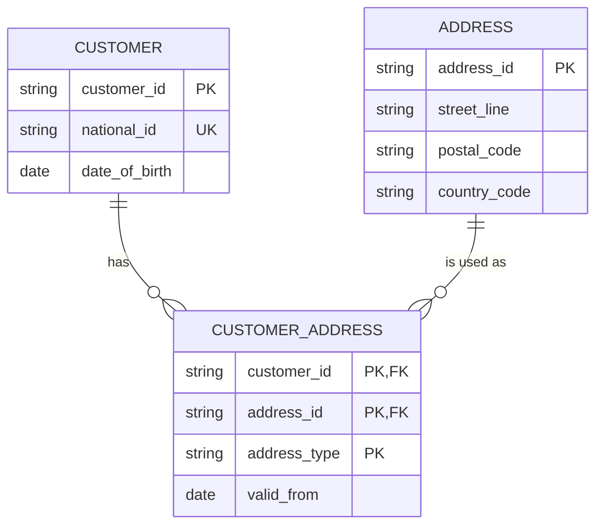
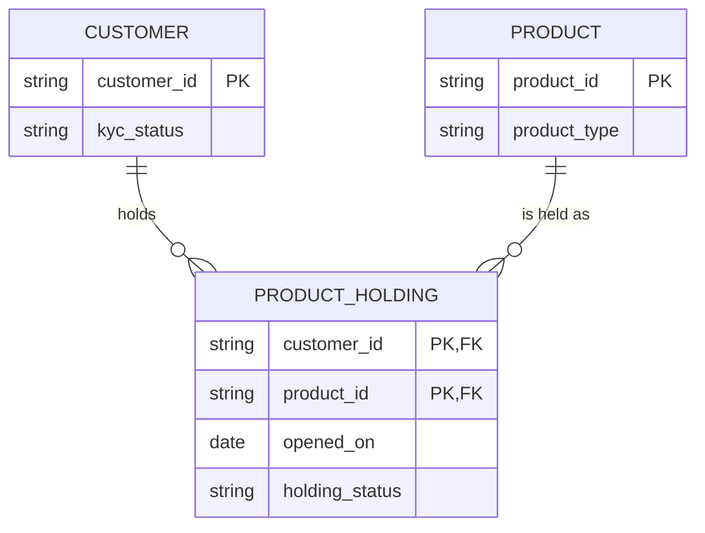

# Logical Data Model

Mermaid type: `erDiagram` (Native fit). Source: Modeling-Diagraming.md, section "Data Architecture & Information Modeling".

Shows data structures, keys, relationships, and cardinalities in normalized form, without tying them to a specific DBMS.

## Example 1: Simple - customer, address, and bridge table

## Example 2: Realistic - customer product holdings

