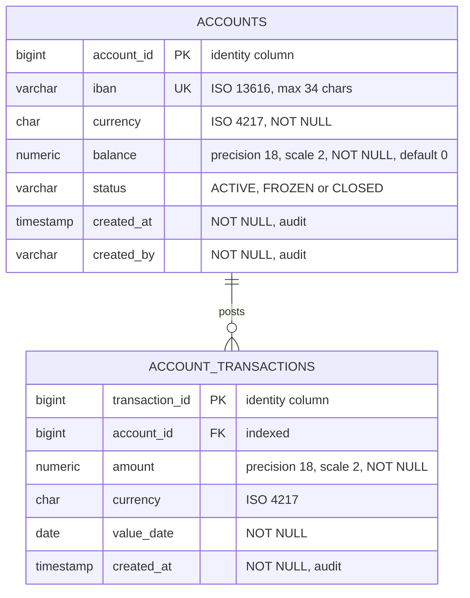
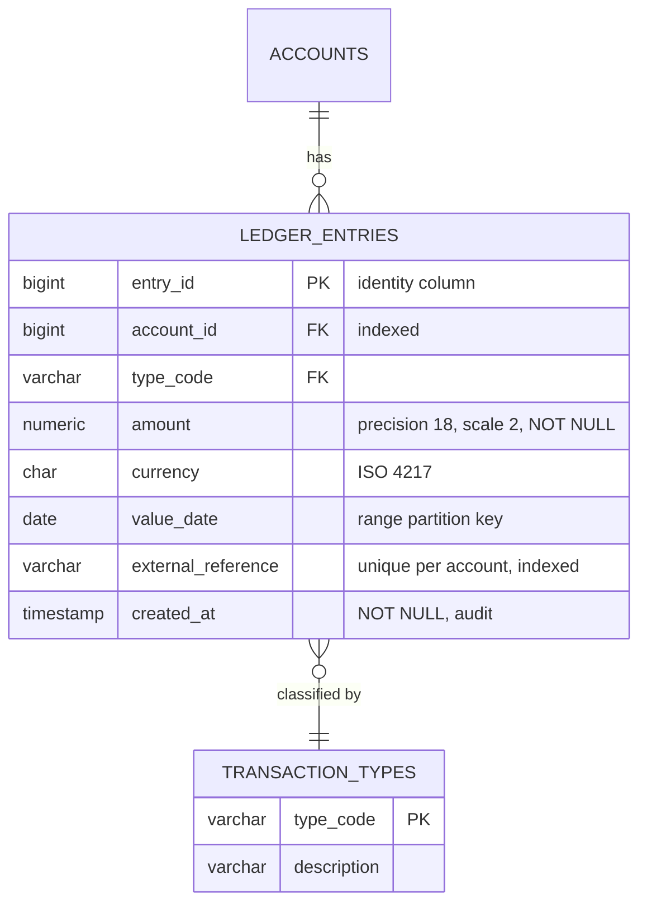

# Physical Data Model

Mermaid type: `erDiagram` (Native fit). Source: Modeling-Diagraming.md, section "Data Architecture & Information Modeling".

Shows the concrete tables, column types, keys, and storage details that will be implemented in the database.

## Example 1: Simple - accounts and account transactions

## Example 2: Realistic - partitioned ledger entries

