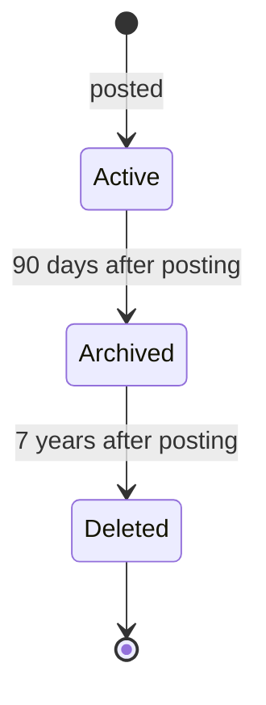
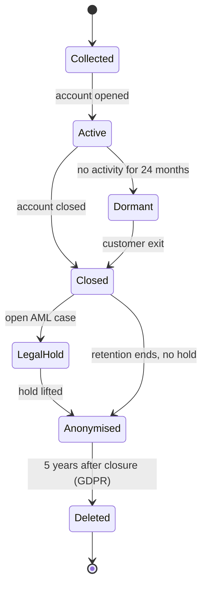

# Data Lifecycle Diagram

Mermaid type: `stateDiagram-v2` (Close fit). Source: Modeling-Diagraming.md, section "Data warehouse".

It answers how long data is retained, when it must be deleted, and which regulatory or operational obligations apply.

## Example 1: Simple - card transaction retention

## Example 2: Realistic - customer data after account closure

