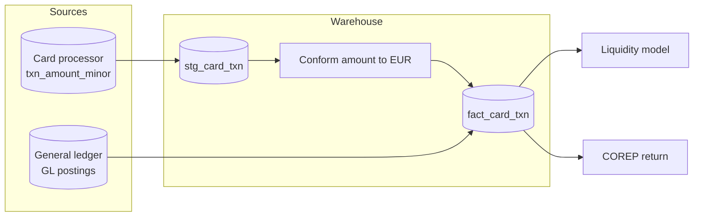

# Data Lineage Diagram

Mermaid type: `flowchart` (Close fit). Source: Modeling-Diagraming.md, section "Data warehouse".

It answers where data came from and which downstream reports, models, or services are affected if a source changes.

## Example 1: Simple - core banking to risk report

## Example 2: Realistic - card transaction field lineage

