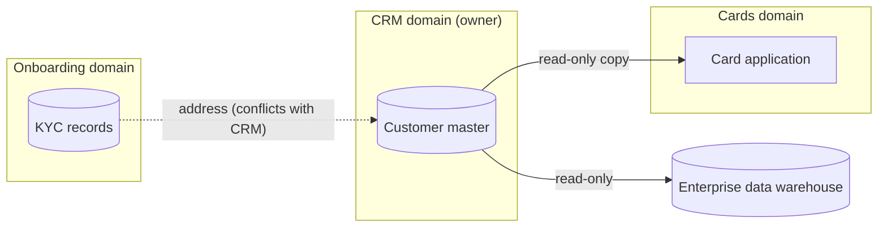
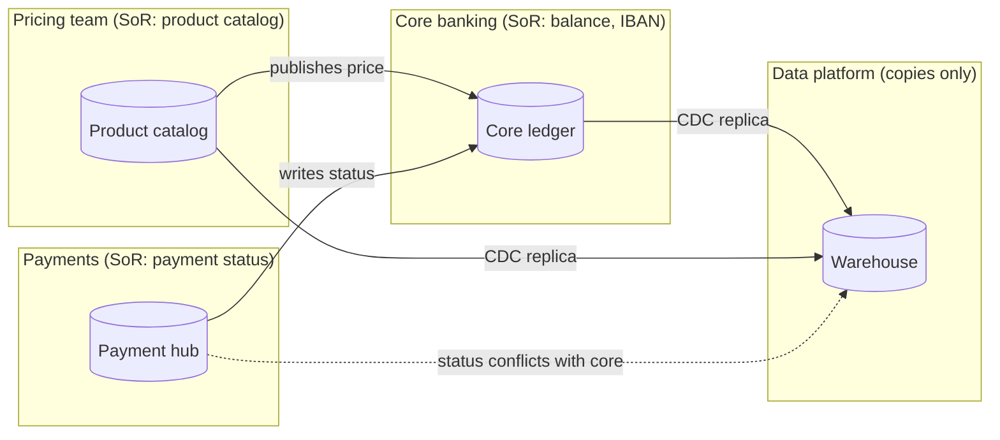

# Data Ownership / System-of-Record Map

Mermaid type: `flowchart` (Close fit). Source: Modeling-Diagraming.md, section "Data warehouse".

It answers which system owns each piece of data, who may update it, and where conflicting sources of truth exist.

## Example 1: Simple - customer master owned by CRM

## Example 2: Realistic - balance, price and payment status ownership

