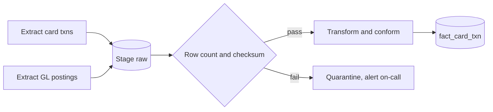
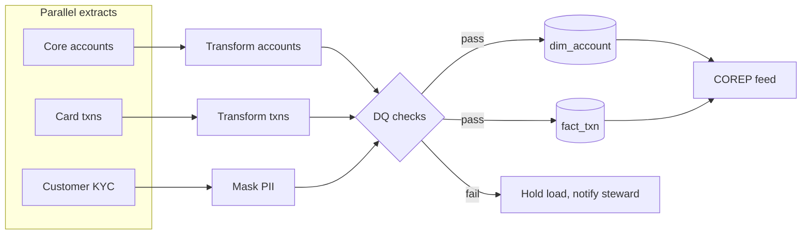

# Data Pipeline / ETL DAG

Mermaid type: `flowchart` (Close fit). Source: Modeling-Diagraming.md, section "Data warehouse".

It answers in what order datasets must be processed, what happens if a transformation fails, and which stages can run in parallel.

## Example 1: Simple - nightly card transaction load

## Example 2: Realistic - parallel extracts merged for regulatory feed

