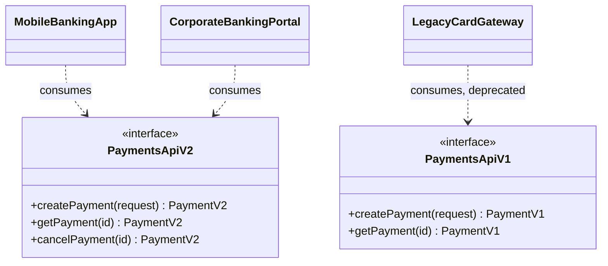
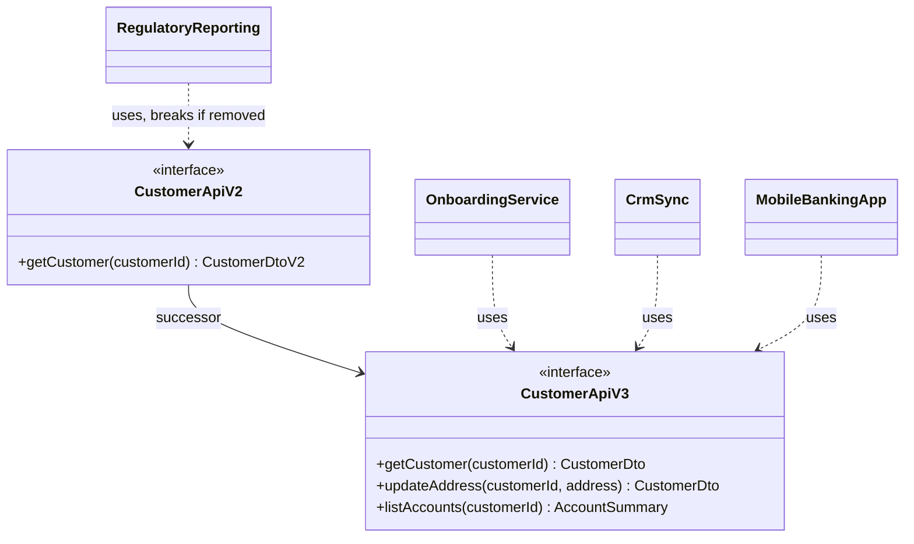

# API Contract / Interface Map

Mermaid type: `classDiagram` (Close fit). Source: Modeling-Diagraming.md, section "Integration, APIs & Distributed Systems".

Shows provided and consumed interfaces, endpoints, versions, and dependencies, answering what could break after a contract change.

## Example 1: Simple - Payments API versions and their consumers

## Example 2: Realistic - Customer API v2 and v3 with dependent consumers

