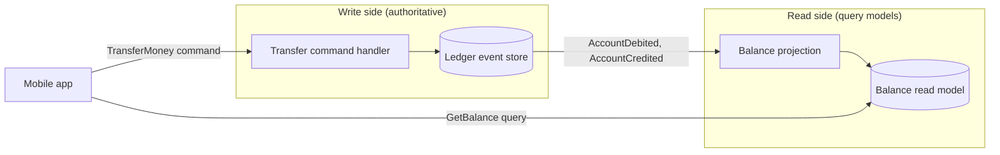
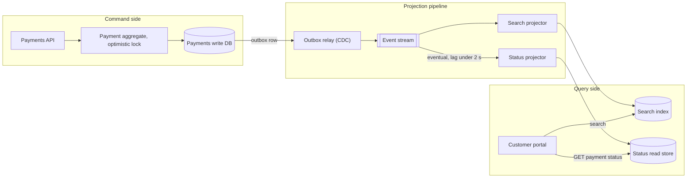

# CQRS Read/Write Architecture Diagram

Mermaid type: `flowchart` (Close fit). Source: Modeling-Diagraming.md, section "Integration, APIs & Distributed Systems".

Separates commands, authoritative write models, projections, and query models, showing where state changes and where eventual consistency can arise.

## Example 1: Simple - Account ledger with a balance read model

## Example 2: Realistic - Payments with outbox and eventual consistency lag

