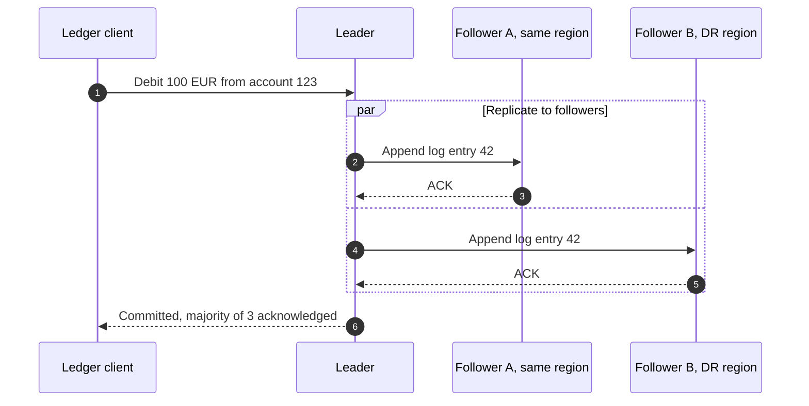
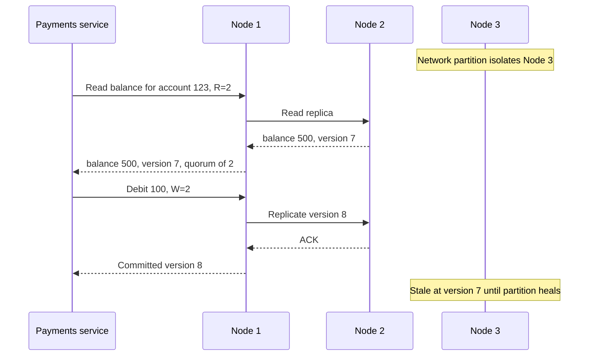

# Distributed Consistency / Replication Diagram

Mermaid type: `sequenceDiagram` (Close fit). Source: Modeling-Diagraming.md, section "Integration, APIs & Distributed Systems".

Shows leaders, replicas, synchronization, quorum, and consistency relationships, including what happens during network partitions or concurrent updates.

## Example 1: Simple - Leader write replicated to two followers

## Example 2: Realistic - Quorum read and write during a network partition

