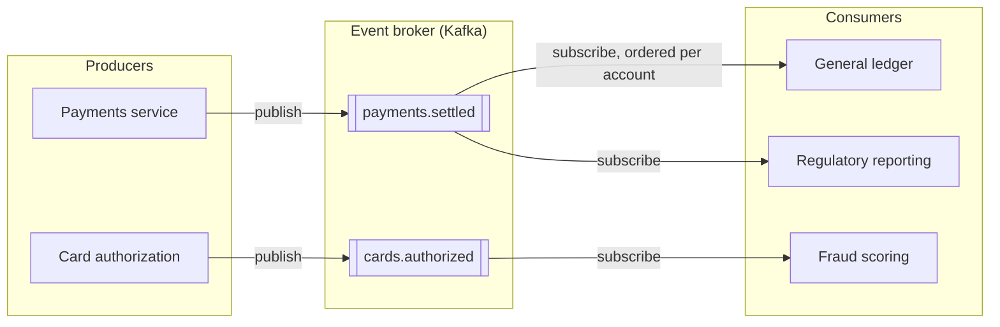
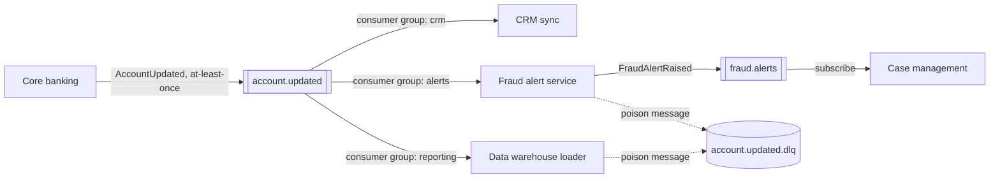

# Event-Driven Architecture Diagram

Mermaid type: `flowchart` (Close fit). Source: Modeling-Diagraming.md, section "Integration, APIs & Distributed Systems".

Maps event producers, brokers, topics, subscriptions, and consumers, showing where coupling is introduced and which delivery or ordering dependencies apply.

## Example 1: Simple - Payments and card events fanning out to consumers

## Example 2: Realistic - Account events with consumer groups and dead-letter handling

