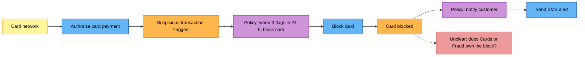

# Event Storming Board (DDD)

Mermaid type: `flowchart` (Approximate fit). Source: Modeling-Diagraming.md, section "Integration, APIs & Distributed Systems".

Uses domain events, commands, actors, policies, and hotspots to explore what actually happens in the domain and where consistency and ownership boundaries may belong.

## Example 1: Simple - Loan application events and commands

```mermaid
flowchart LR
    classDef actor fill:#fff59d,stroke:#f9a825,color:#000
    classDef command fill:#64b5f6,stroke:#0d47a1,color:#000
    classDef event fill:#ffb74d,stroke:#e65100,color:#000
    classDef policy fill:#ce93d8,stroke:#6a1b9a,color:#000
    classDef hotspot fill:#ef9a9a,stroke:#b71c1c,color:#000
    Applicant["Applicant"]:::actor --> Submit["Submit loan application"]:::command
    Submit --> Submitted["Loan application submitted"]:::event
    Submitted --> Rule1["Policy: when submitted, request credit check"]:::policy
    Rule1 --> Check["Request credit check"]:::command
    Check --> Scored["Credit score received"]:::event
    Scored --> Rule2["Policy: when score below threshold, decline"]:::policy
    Rule2 --> Decline["Decline application"]:::command
    Decline --> Declined["Loan declined"]:::event
    Declined -.-> Q["Who sends the decline letter?"]:::hotspot
```

## Example 2: Realistic - Card fraud policy blocking a card

