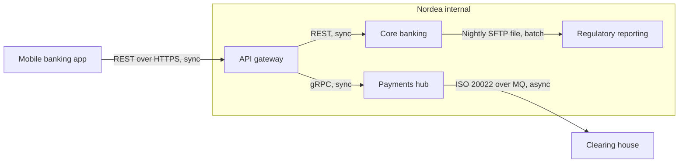
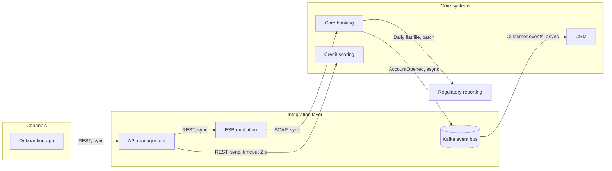

# Integration Architecture Diagram

Mermaid type: `flowchart` (Close fit). Source: Modeling-Diagraming.md, section "Integration, APIs & Distributed Systems".

Maps systems, APIs, brokers, integration middleware, protocols, and connections, showing which integrations are synchronous, asynchronous, or batch-based.

## Example 1: Simple - Payments and core banking behind an API gateway

## Example 2: Realistic - Customer onboarding with ESB, event bus and batch reporting

