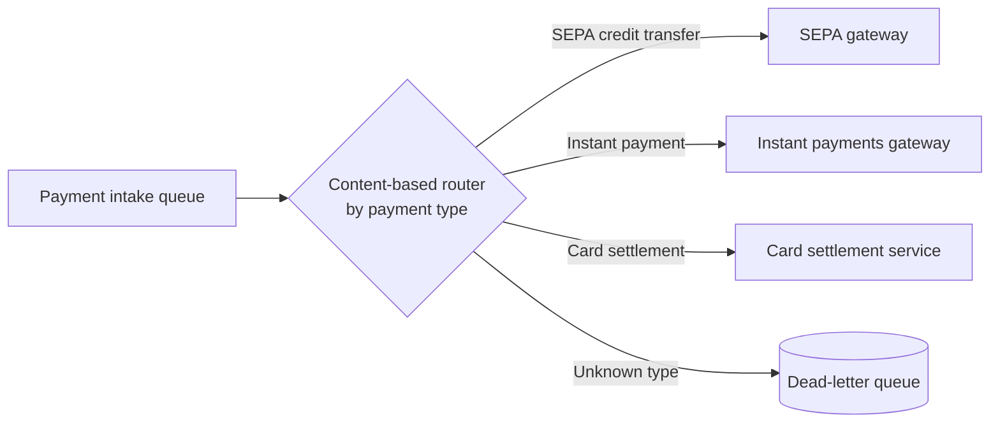
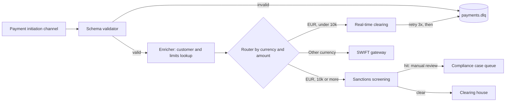

# Message Routing Diagram

Mermaid type: `flowchart` (Close fit). Source: Modeling-Diagraming.md, section "Integration, APIs & Distributed Systems".

Shows routing, filtering, transformation, enrichment, aggregation, and delivery paths, including where retries and dead-letter handling apply.

## Example 1: Simple - Content-based router for payment types

## Example 2: Realistic - Validation, enrichment and routing of outgoing payments

