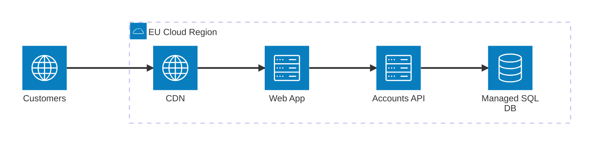
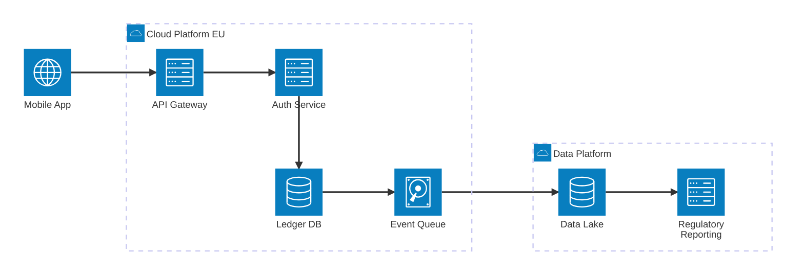

# Cloud Architecture Diagram

Mermaid type: `architecture-beta` (Close fit). Source: Modeling-Diagraming.md, section "Infrastructure, Deployment & Network Architecture".

Represents managed services, regions, accounts, subscriptions, storage, compute, and connectivity.

## Example 1: Simple - web app, CDN, API and managed database in one region

## Example 2: Realistic - mobile payments on cloud services with reporting pipeline

