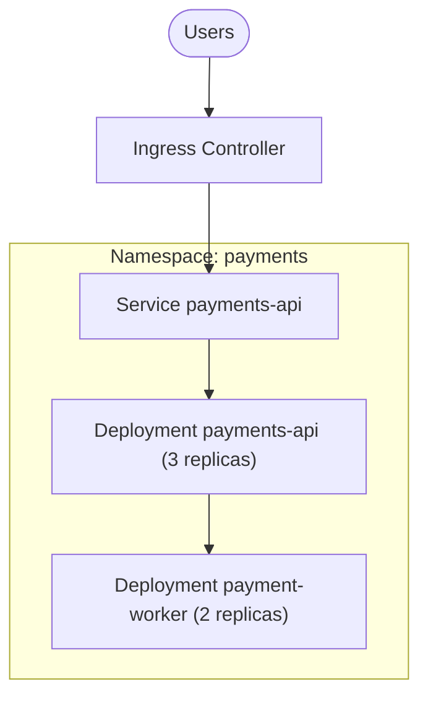
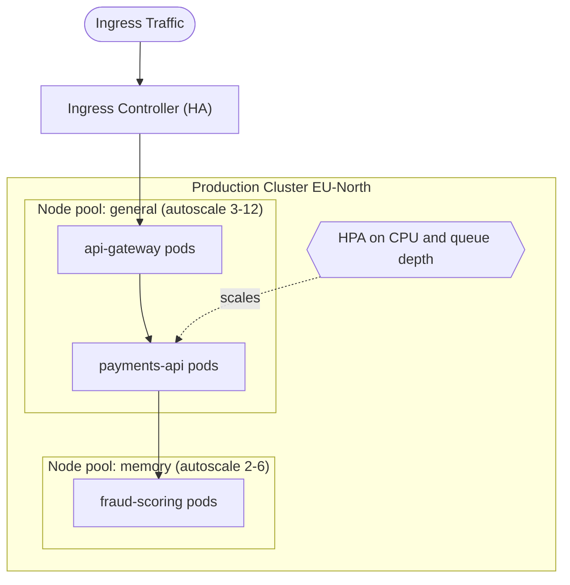

# Cluster / Orchestration Diagram

Mermaid type: `flowchart` (Approximate fit). Source: Modeling-Diagraming.md, section "Infrastructure, Deployment & Network Architecture".

Shows Kubernetes clusters or equivalent orchestration structures, workloads, services, ingress, and scaling groups.

## Example 1: Simple - ingress to a service and its deployments in one namespace

## Example 2: Realistic - node pools with autoscaling for API and fraud workloads

