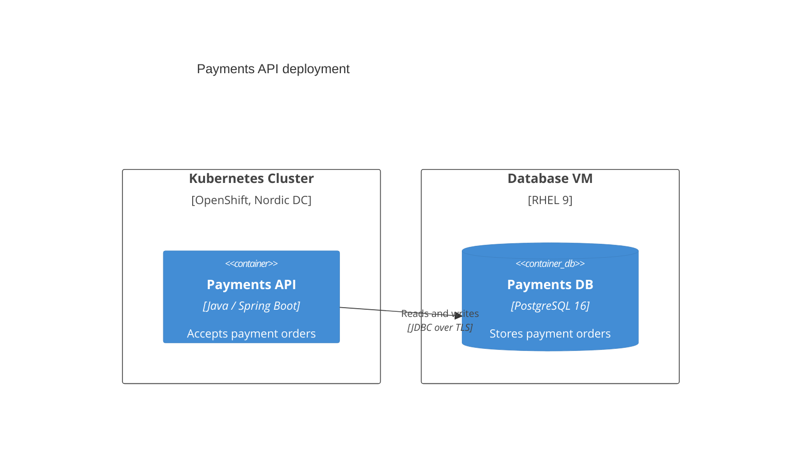
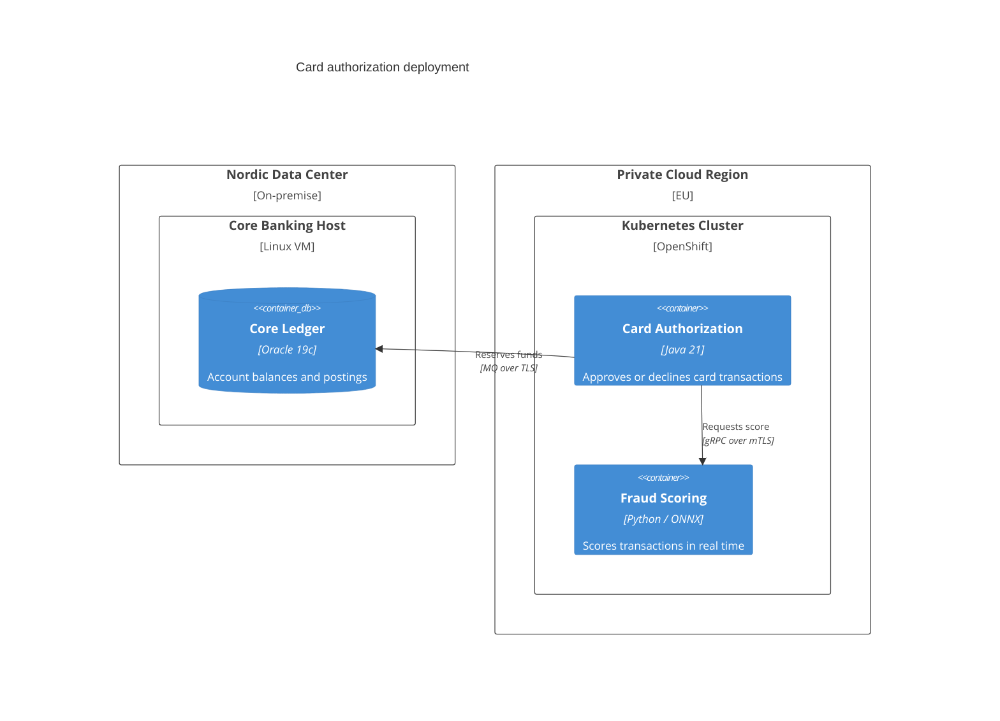

# Deployment Diagram (UML / C4 variants)

Mermaid type: `C4Deployment` (Native fit). Source: Modeling-Diagraming.md, section "Infrastructure, Deployment & Network Architecture".

Maps software artifacts, services, and containers onto execution environments and infrastructure nodes.

## Example 1: Simple - API on Kubernetes, database on VM

## Example 2: Realistic - card authorization across on-premise and private cloud

