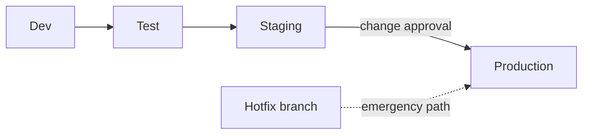
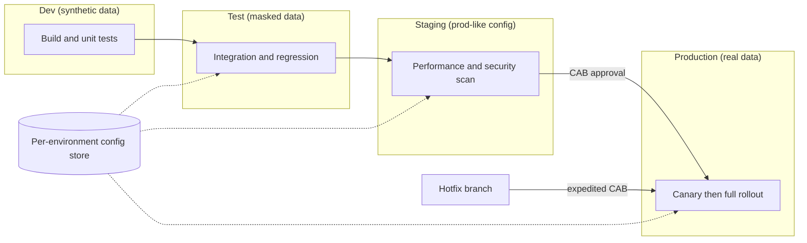

# Environment / Release Topology

Mermaid type: `flowchart` (Close fit). Source: Modeling-Diagraming.md, section "Infrastructure, Deployment & Network Architecture".

Maps development, testing, staging, production, and their configuration or data dependencies.

## Example 1: Simple - promotion path with hotfix route

## Example 2: Realistic - promotion gates with per-environment configuration and data

