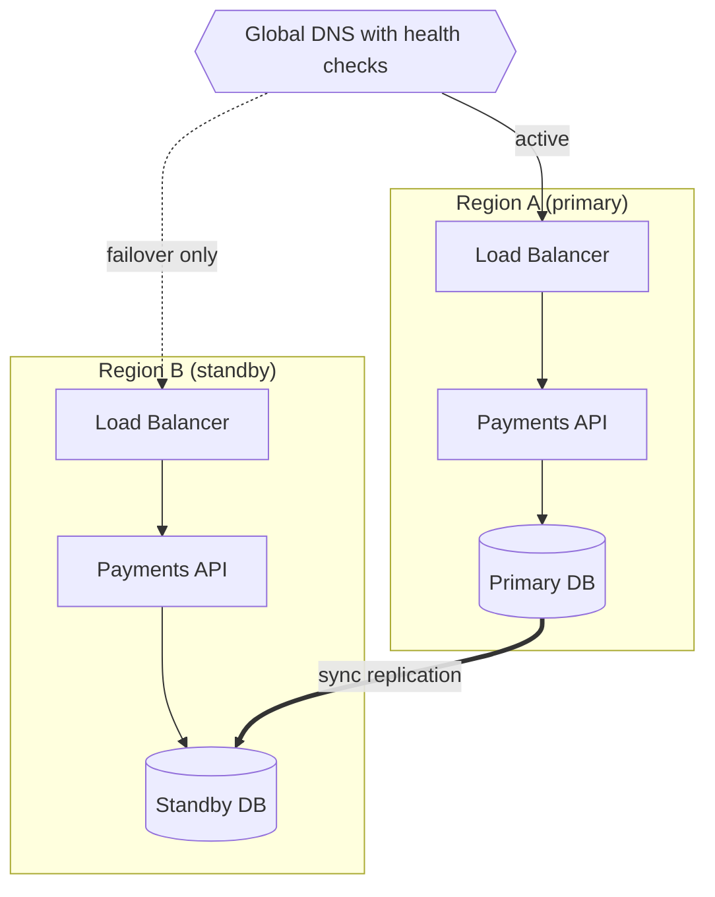
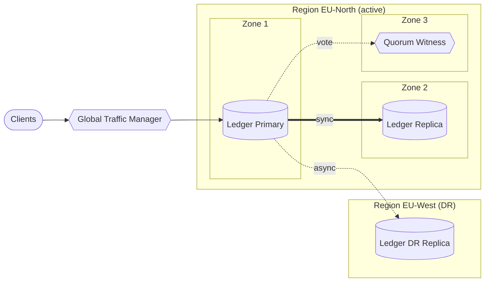

# High-Availability / Multi-Region Diagram

Mermaid type: `flowchart` (Close fit). Source: Modeling-Diagraming.md, section "Infrastructure, Deployment & Network Architecture".

Shows redundant components, availability zones, regions, failover paths, and replication relationships.

## Example 1: Simple - active-passive region failover

## Example 2: Realistic - ledger cluster across three zones with DR region

