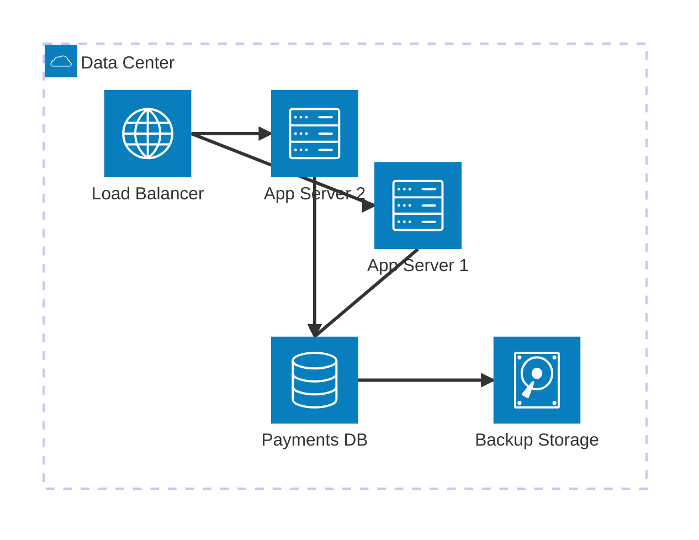
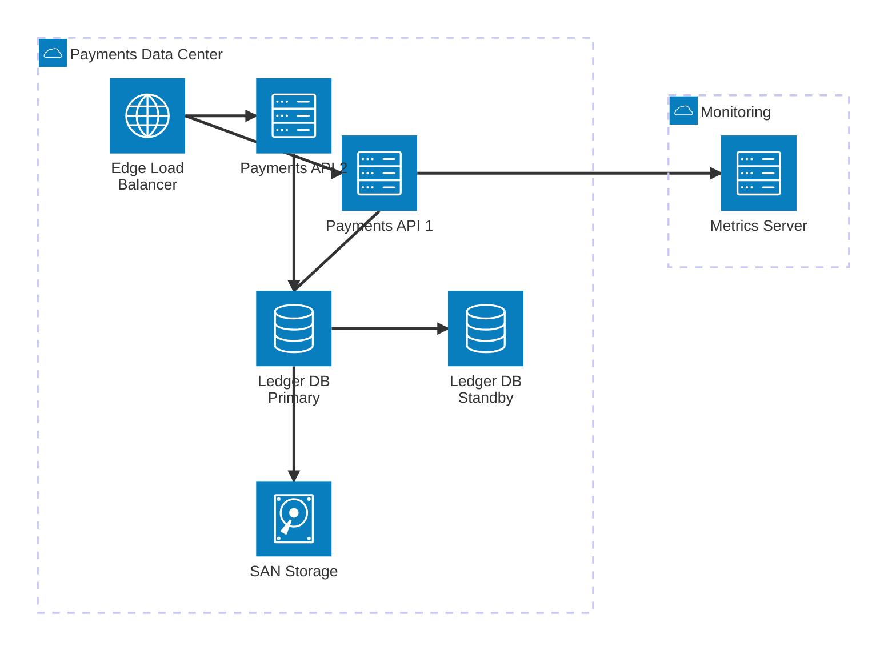

# Infrastructure Topology Diagram

Mermaid type: `architecture-beta` (Close fit). Source: Modeling-Diagraming.md, section "Infrastructure, Deployment & Network Architecture".

Shows servers, load balancers, databases, storage, networking, and supporting infrastructure.

## Example 1: Simple - load balancer, two app servers, database

## Example 2: Realistic - payments platform with HA database and monitoring

