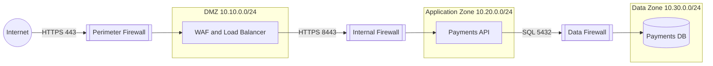
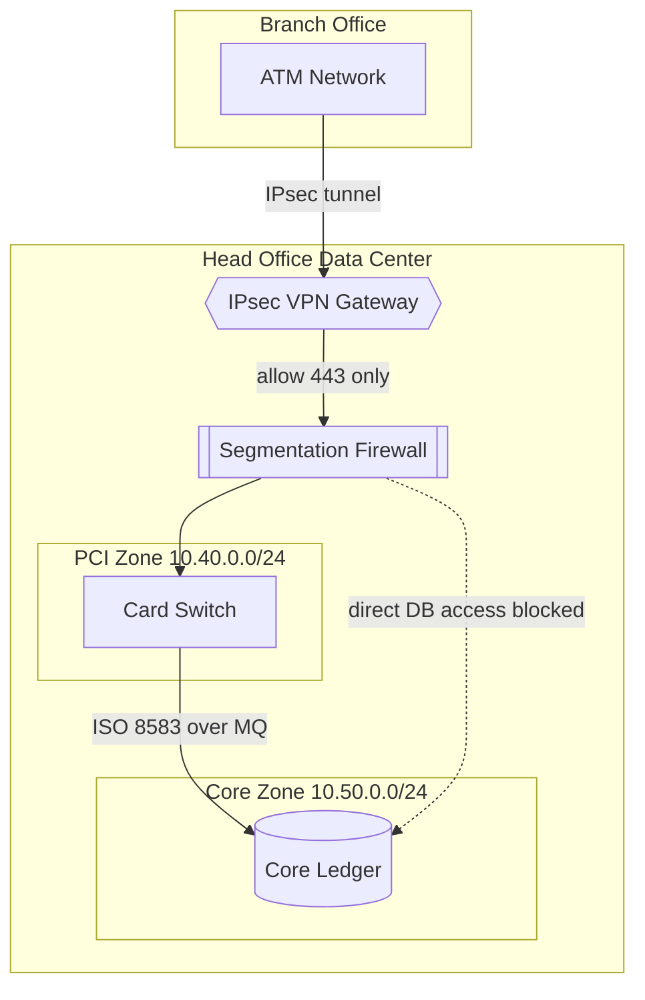

# Network Topology Diagram

Mermaid type: `flowchart` (Close fit). Source: Modeling-Diagraming.md, section "Infrastructure, Deployment & Network Architecture".

Shows networks, subnets, routers, firewalls, gateways, and connections.

## Example 1: Simple - internet ingress through DMZ into application and data zones

## Example 2: Realistic - branch ATM network over IPsec into PCI and core zones

