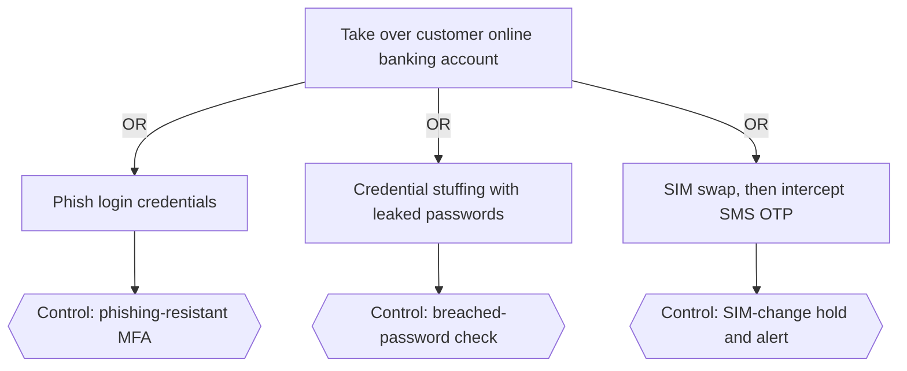
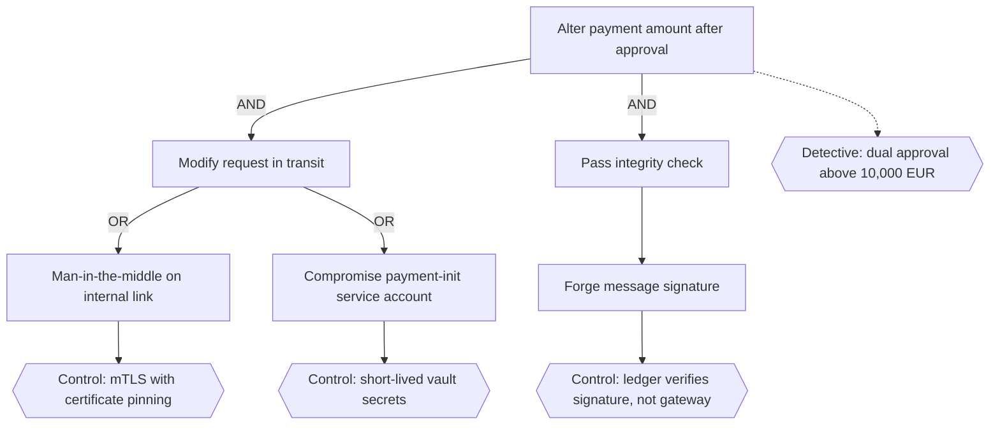

# Attack Tree

Mermaid type: `flowchart` (Close fit). Source: Modeling-Diagraming.md, section "Security, Privacy & Trust".

The diagram answers how an attacker could reach a specific outcome and which preventive or detective controls interrupt the attack.

## Example 1: Simple - Account takeover

## Example 2: Realistic - Altering a payment amount after approval

