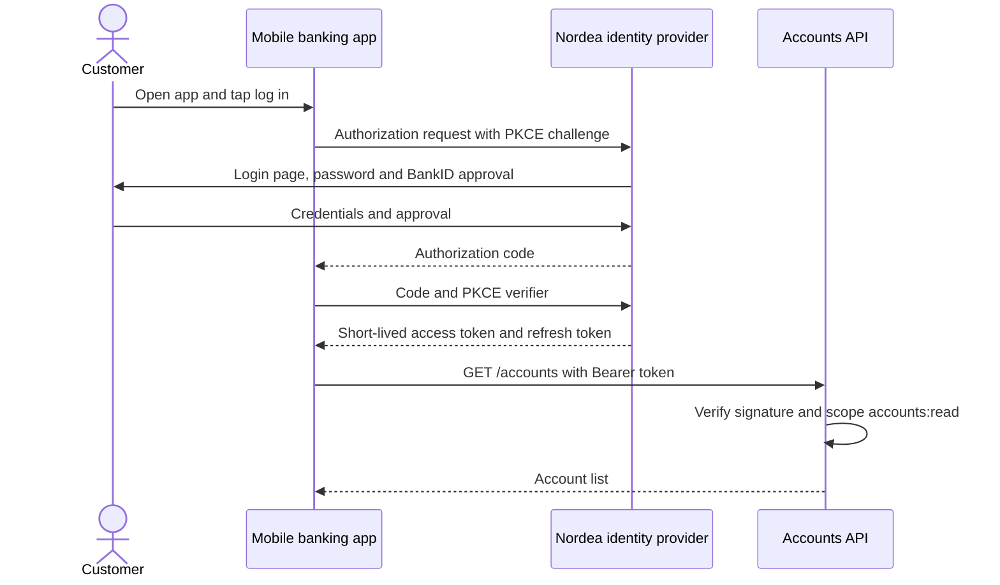
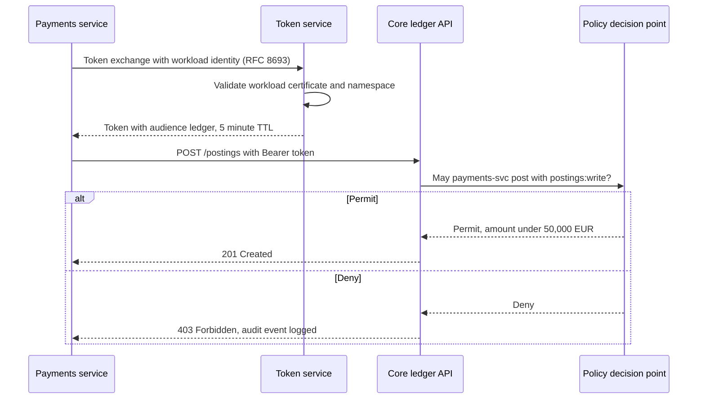

# Identity & Authorization Flow Diagram

Mermaid type: `sequenceDiagram` (Native fit). Source: Modeling-Diagraming.md, section "Security, Privacy & Trust".

The diagram answers who authenticates whom, where permissions are enforced, and how identities and credentials flow through the system.

## Example 1: Simple - Mobile banking login with OAuth2 authorization code and PKCE

## Example 2: Realistic - Service-to-service token exchange with policy check

