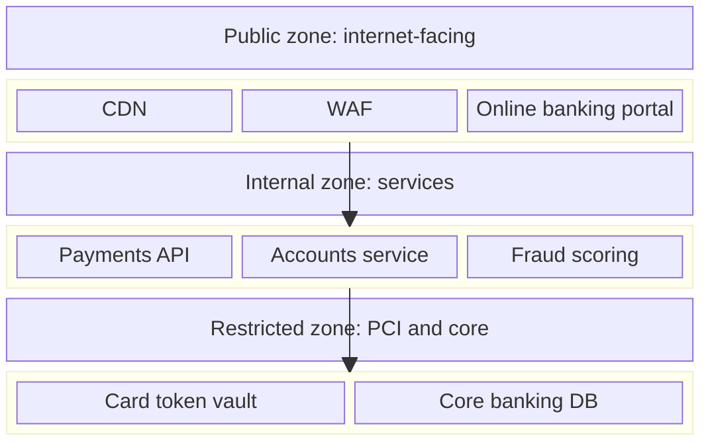
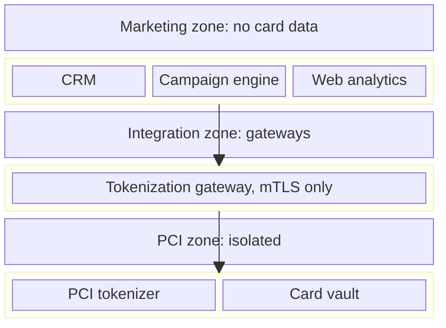

# Security Zone / Segmentation Diagram

Mermaid type: `block-beta` (Close fit). Source: Modeling-Diagraming.md, section "Security, Privacy & Trust".

The diagram answers which assets must be isolated and where firewalls, gateways, and access restrictions should be enforced.

## Example 1: Simple - Public, internal, and restricted zones

## Example 2: Realistic - PCI zone reachable only through an integration gateway

