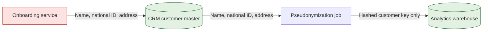
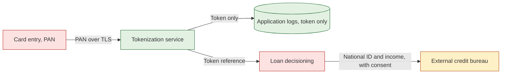

# Sensitive Data Flow / Privacy Map

Mermaid type: `flowchart` (Close fit). Source: Modeling-Diagraming.md, section "Security, Privacy & Trust".

The diagram answers where sensitive information is processed, who can access it, and which privacy obligations and exposure risks exist.

## Example 1: Simple - Customer PII from onboarding to analytics

## Example 2: Realistic - Card number tokenized before logging, credit bureau check

