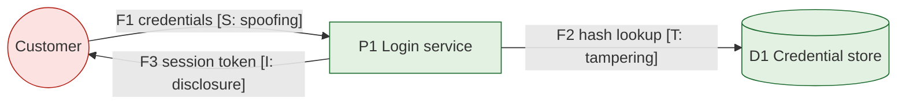
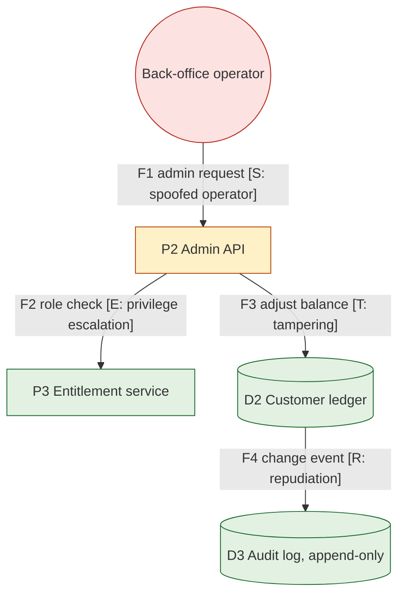

# Threat Modeling DFD

Mermaid type: `flowchart` (Close fit). Source: Modeling-Diagraming.md, section "Security, Privacy & Trust".

The diagram answers what can be attacked and where spoofing, tampering, information disclosure, or privilege escalation could occur.

## Example 1: Simple - Login flow with spoofing risk

## Example 2: Realistic - Back-office admin API with privilege escalation

