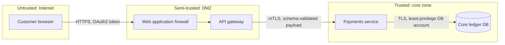
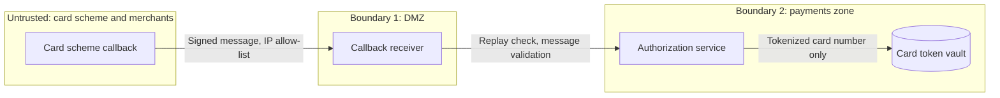

# Trust Boundary Diagram

Mermaid type: `flowchart` (Close fit). Source: Modeling-Diagraming.md, section "Security, Privacy & Trust".

The diagram answers where untrusted input enters and which interactions require authentication, validation, or other controls.

## Example 1: Simple - Internet to core zone

## Example 2: Realistic - Card scheme callback across a partner boundary

