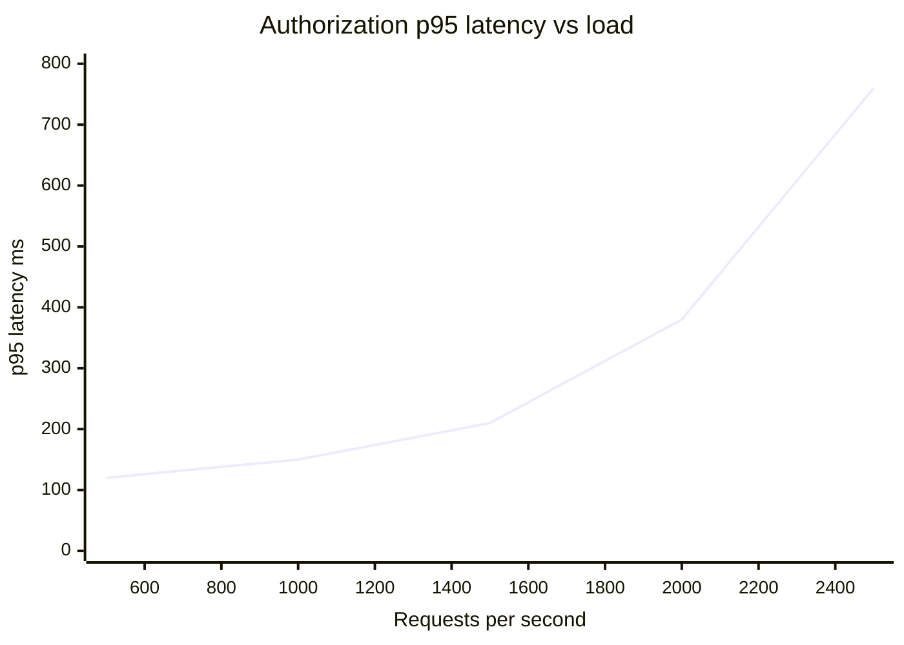
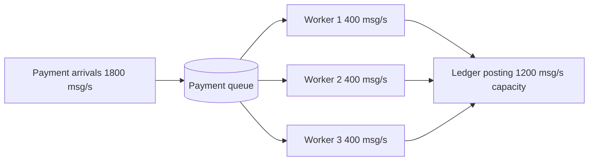

# Capacity / Queuing Model

Mermaid type: `xychart-beta` (load vs latency) + `flowchart` (queues) (Close fit). Source: Modeling-Diagraming.md, section "Reliability, Performance & Quality Attributes".

Represents arrival rates, service capacity, queues, and workers to show where bottlenecks form and how latency and throughput change as load increases.

## Example 1: Simple - latency curve vs requests per second

## Example 2: Realistic - payment queue with three workers

