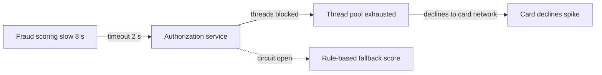
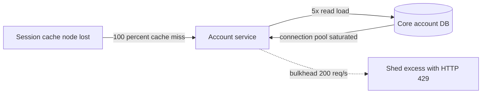

# Failure Propagation Diagram

Mermaid type: `flowchart` LR with timeout and fallback edges (Close fit). Source: Modeling-Diagraming.md, section "Reliability, Performance & Quality Attributes".

Shows how failures, congestion, timeouts, or resource exhaustion spread through dependencies, and where isolation or fallback behavior should stop the spread.

## Example 1: Simple - fraud service slowdown exhausts threads

## Example 2: Realistic - cache loss overloads account database

