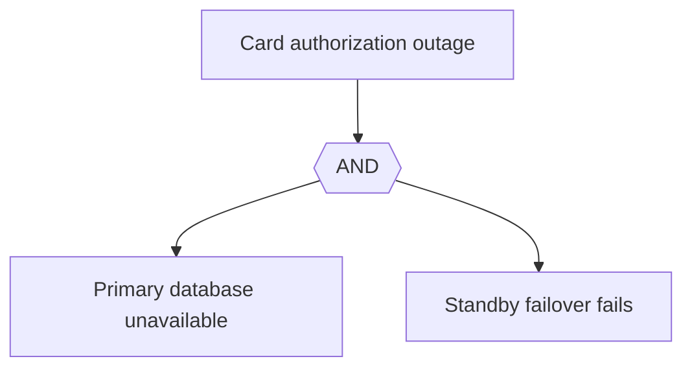
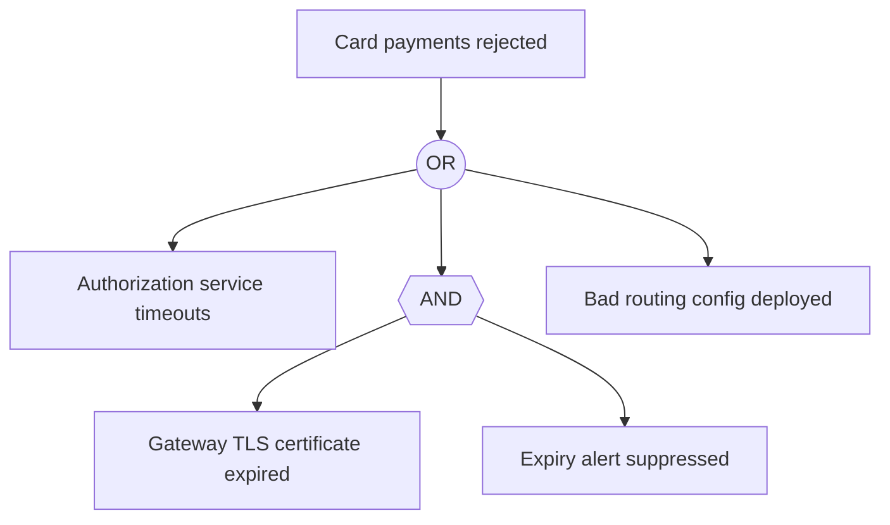

# Fault Tree Analysis (FTA)

Mermaid type: `flowchart` TD with AND/OR gate nodes (Approximate fit). Source: Modeling-Diagraming.md, section "Reliability, Performance & Quality Attributes".

Decomposes an undesirable failure into contributing events and conditions joined by logical gates, showing which combinations of failures could cause an outage.

## Example 1: Simple - database and failover both fail

## Example 2: Realistic - card payments rejected

