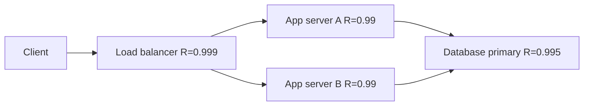
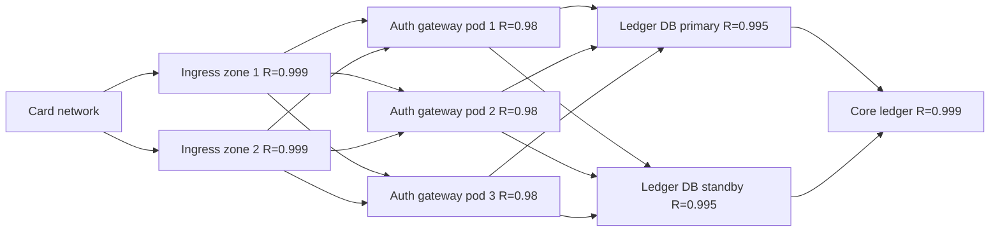

# Reliability Block Diagram (RBD)

Mermaid type: `flowchart` LR with parallel branches (Approximate fit). Source: Modeling-Diagraming.md, section "Reliability, Performance & Quality Attributes".

Models series, parallel, and redundant dependencies so that component reliabilities can be combined and the availability gain from redundancy can be judged.

## Example 1: Simple - redundant app servers in front of a database

## Example 2: Realistic - card authorization path

