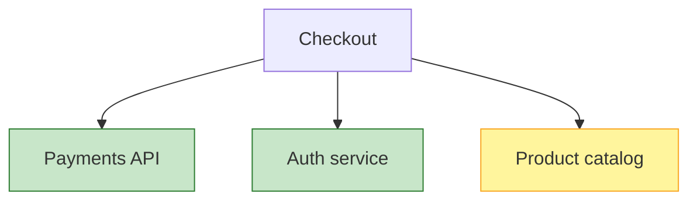
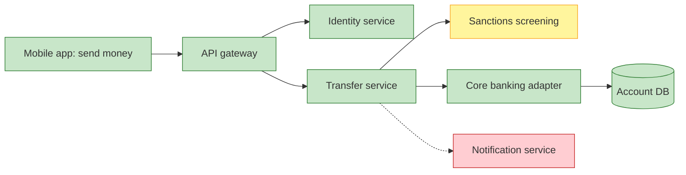

# Service Dependency / Health Model

Mermaid type: `flowchart` with `classDef` health colors (Close fit). Source: Modeling-Diagraming.md, section "Reliability, Performance & Quality Attributes".

Maps services and dependencies with health signals and degradation states, showing which failures affect critical user journeys and SLOs.

## Example 1: Simple - checkout dependencies

## Example 2: Realistic - mobile money transfer journey

