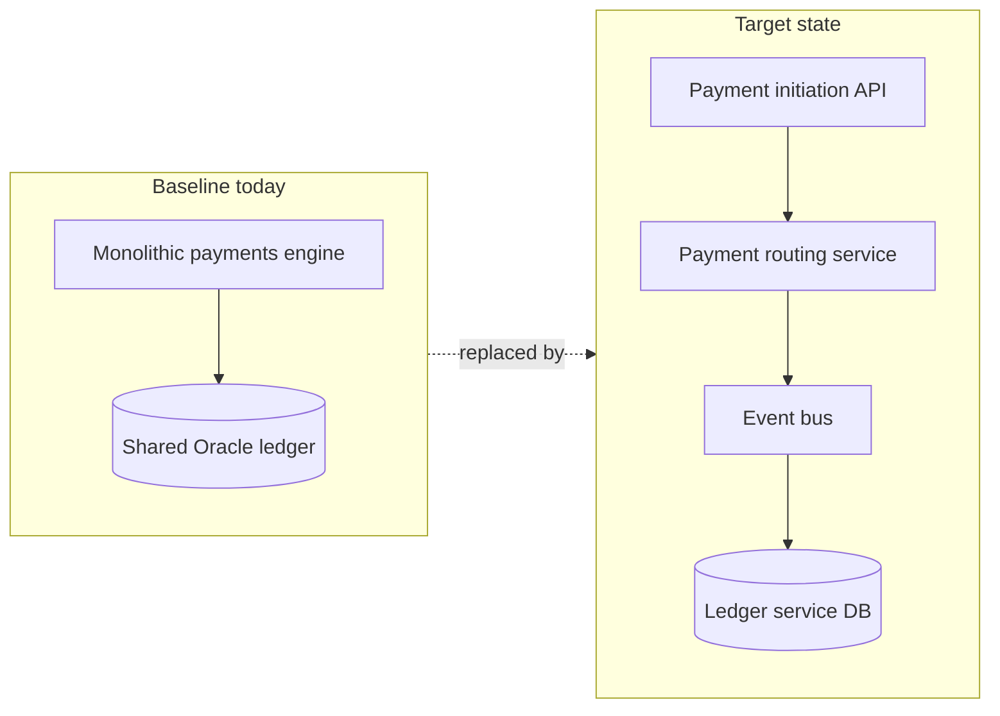
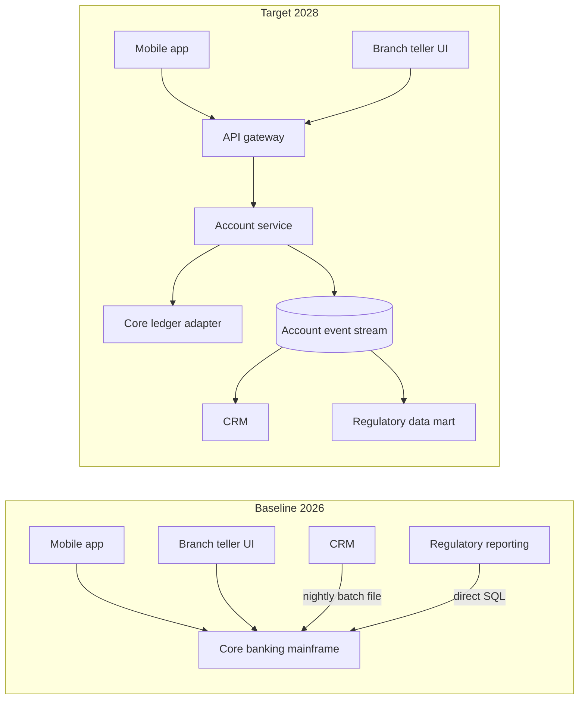

# Baseline vs. Target Architecture Diagram

Mermaid type: `flowchart` (Close fit). Source: Modeling-Diagraming.md, section "Architecture Evolution, Migration & Planning".

Compares the current architecture with the desired future structure, showing what must change, which limitations are removed, and which new dependencies are introduced.

## Example 1: Simple - Payments monolith to target services

## Example 2: Realistic - Core banking decoupling

