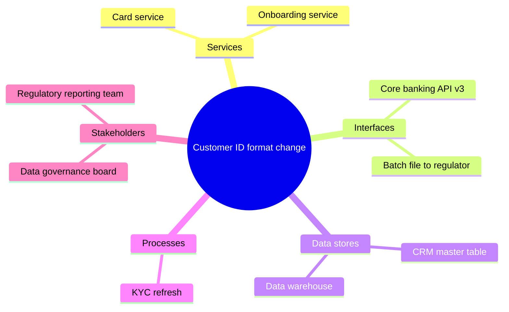
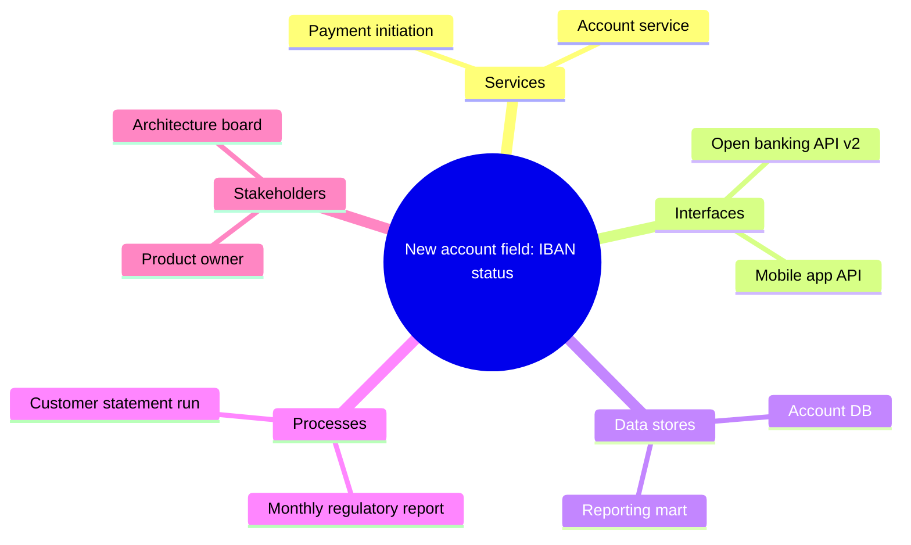

# Change Impact Diagram

Mermaid type: `mindmap` (Close fit). Source: Modeling-Diagraming.md, section "Architecture Evolution, Migration & Planning".

Maps a proposed change to affected services, interfaces, data stores, business processes, and stakeholders, answering what else may break or need modification and who must coordinate or approve the change.

## Example 1: Simple - Customer ID format change

## Example 2: Realistic - New account field

