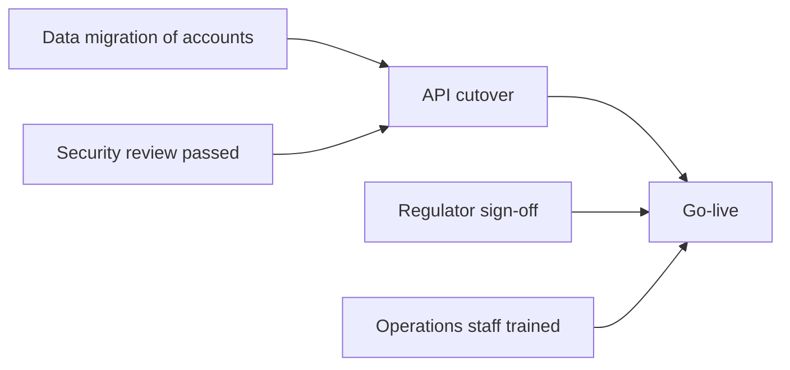
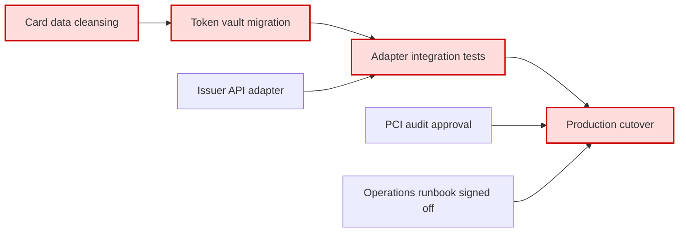

# Migration Dependency Graph

Mermaid type: `flowchart` (Close fit). Source: Modeling-Diagraming.md, section "Architecture Evolution, Migration & Planning".

Shows technical, business, data, and organizational prerequisites between migration tasks, answering what must happen first, which tasks block other work, and where the critical path runs.

## Example 1: Simple - Go-live prerequisites

## Example 2: Realistic - Card platform critical path

