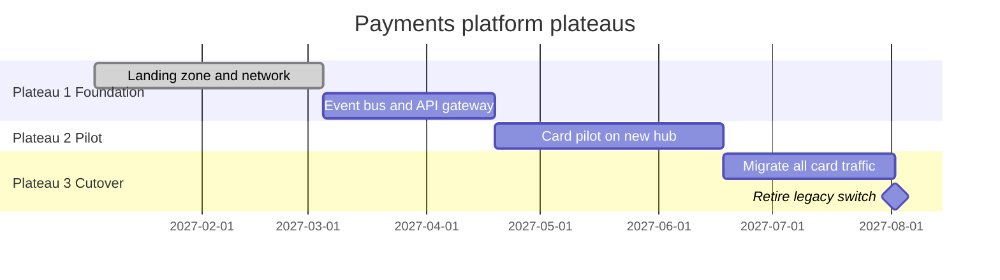
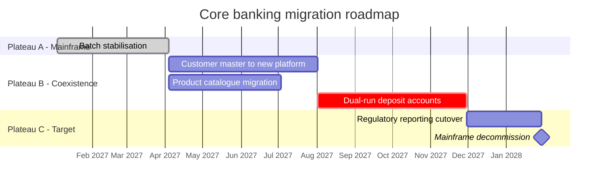

# Migration Roadmap / Plateau Diagram (ArchiMate)

Mermaid type: `gantt` (Close fit). Source: Modeling-Diagraming.md, section "Architecture Evolution, Migration & Planning".

Shows architectural plateaus, implementation work, gaps, and transitions over time, answering in what order changes should occur and which dependencies constrain the sequence.

## Example 1: Simple - Payments platform plateaus

## Example 2: Realistic - Core banking migration with plateaus

