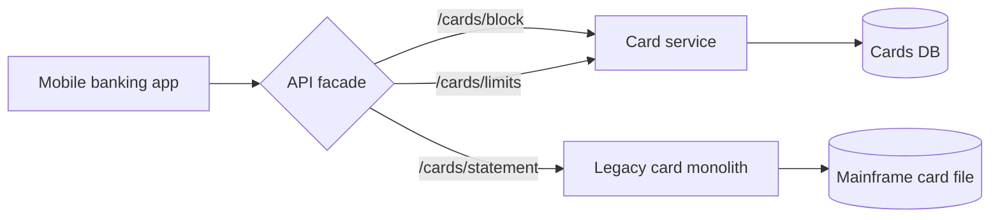
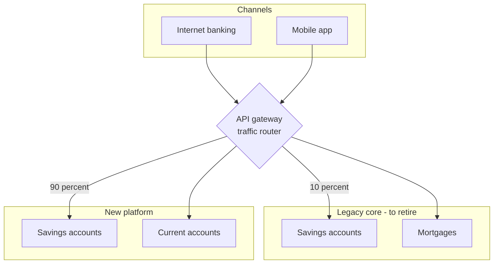

# Strangler Migration Diagram

Mermaid type: `flowchart` (Close fit). Source: Modeling-Diagraming.md, section "Architecture Evolution, Migration & Planning".

Shows legacy and replacement systems coexisting while responsibilities are incrementally redirected, answering which capabilities can move independently, how traffic is switched, and when the legacy implementation can be retired.

## Example 1: Simple - Card endpoints behind a facade

## Example 2: Realistic - Savings accounts shifted by traffic share

