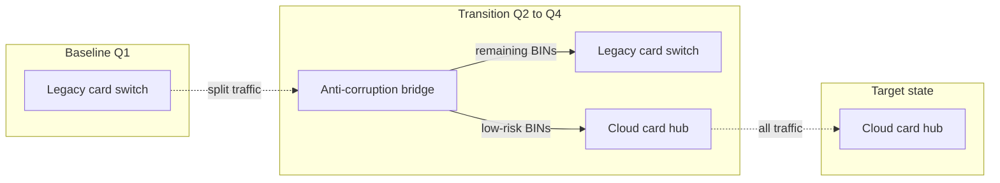
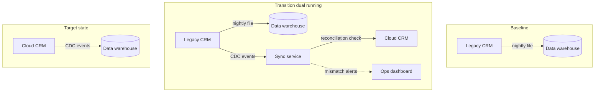

# Transition Architecture Diagram (ArchiMate)

Mermaid type: `flowchart` (Close fit). Source: Modeling-Diagraming.md, section "Architecture Evolution, Migration & Planning".

Represents intermediate architectural states between baseline and target, showing what must coexist during migration and which viable states the organization can operate in.

## Example 1: Simple - Card switch during split traffic

## Example 2: Realistic - CRM integration during dual running

