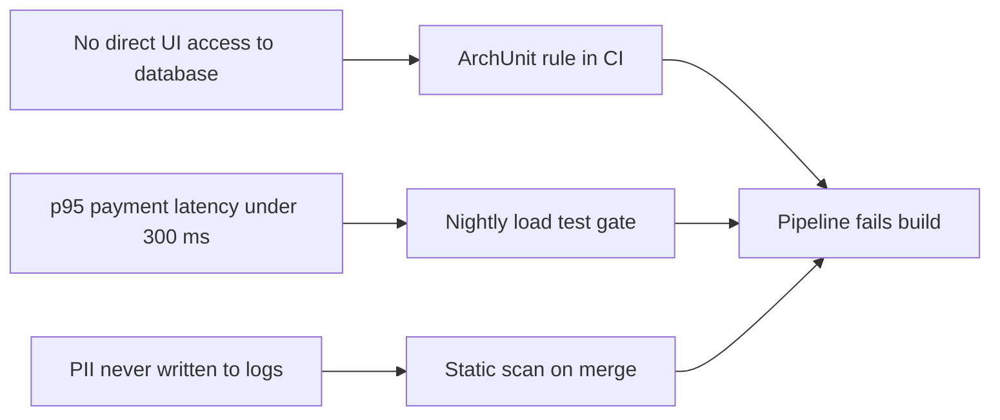
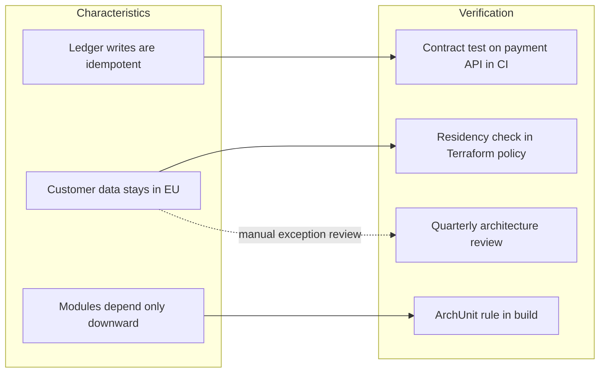

# Architecture Fitness Function Map

Mermaid type: `flowchart` (Close fit). Source: Modeling-Diagraming.md, section "Architecture Evaluation & Decision Support".

Connects architectural characteristics and constraints to automated or manual verification mechanisms, showing how architecture rules are checked continuously and which properties could silently regress.

## Example 1: Simple - Automated checks in CI

## Example 2: Realistic - Characteristics mapped to verification

