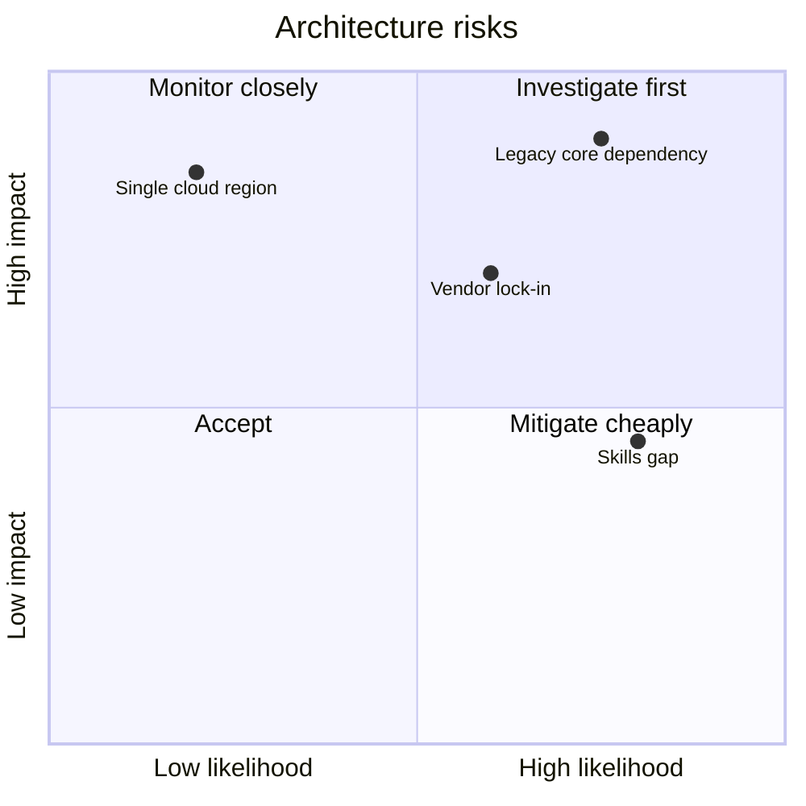
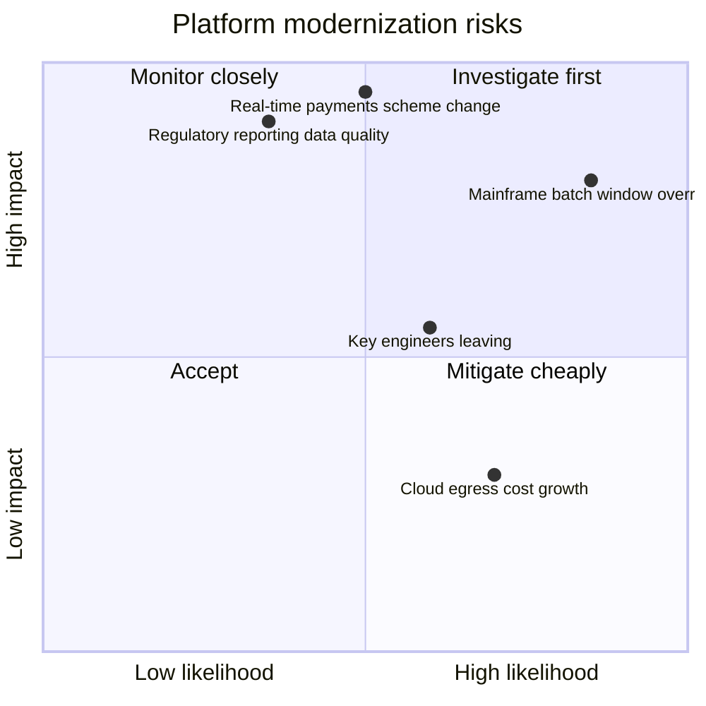

# Architecture Risk Map

Mermaid type: `quadrantChart` (Close fit). Source: Modeling-Diagraming.md, section "Architecture Evaluation & Decision Support".

Places risks against impact and likelihood, showing which architectural risks to investigate first and where verification effort belongs.

## Example 1: Simple - Core platform risks

## Example 2: Realistic - Platform modernization risks

