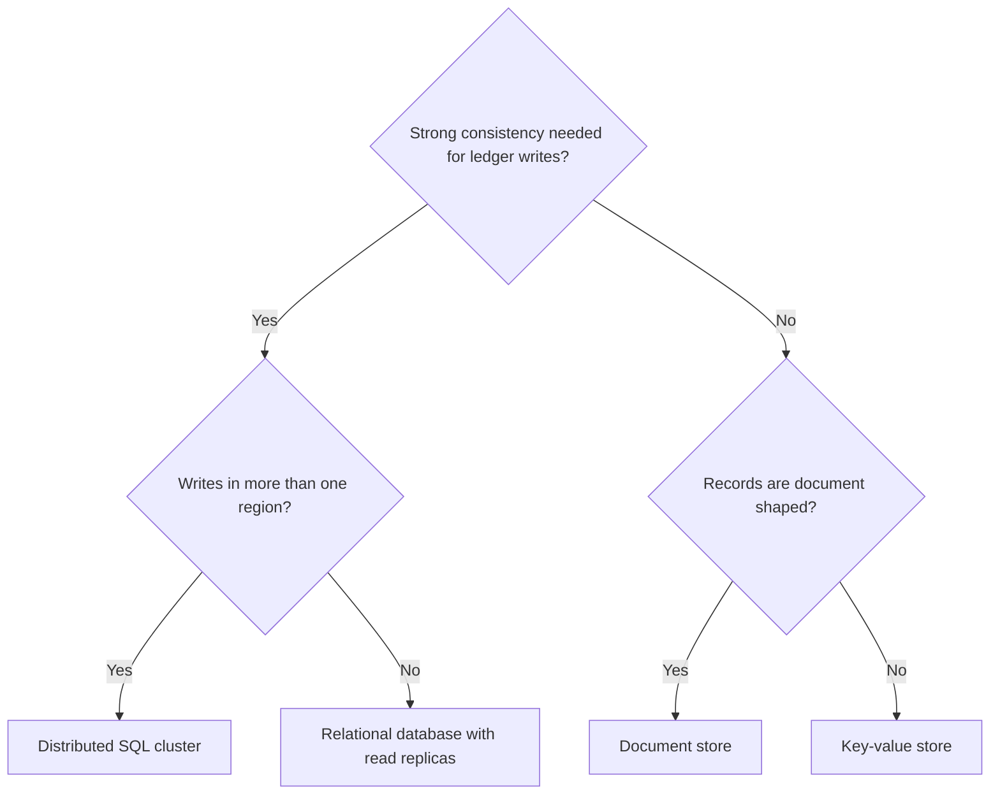
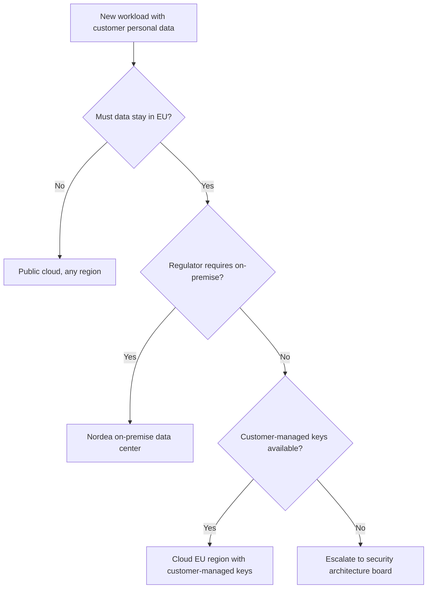

# Decision Tree

Mermaid type: `flowchart` (Close fit). Source: Modeling-Diagraming.md, section "Architecture Evaluation & Decision Support".

Represents decisions, branching conditions, possible outcomes, and consequences, showing which architectural option fits under different constraints.

## Example 1: Simple - Database choice

## Example 2: Realistic - Hosting by data residency

