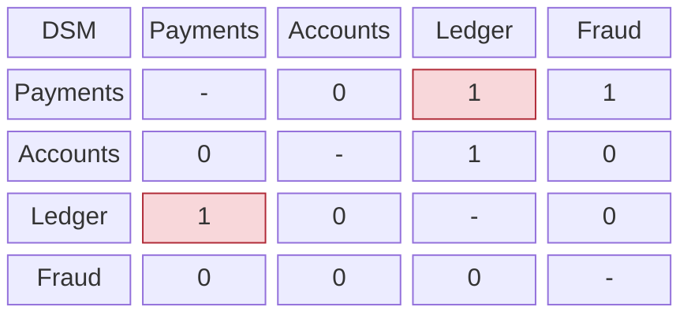
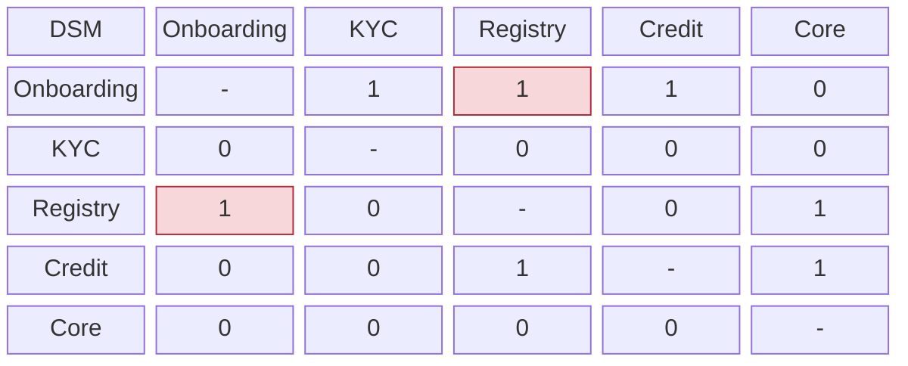

# Dependency Structure Matrix (DSM)

Mermaid type: `block-beta` (Approximate fit). Source: Modeling-Diagraming.md, section "Architecture Evaluation & Decision Support".

A square matrix visualizing dependencies between components, showing where coupling concentrates, which elements can be separated, and which cycles block independent evolution.

## Example 1: Simple - Payments service dependencies

Row depends on column; `1` marks a dependency, red cells form a cycle.

## Example 2: Realistic - Customer onboarding dependencies

