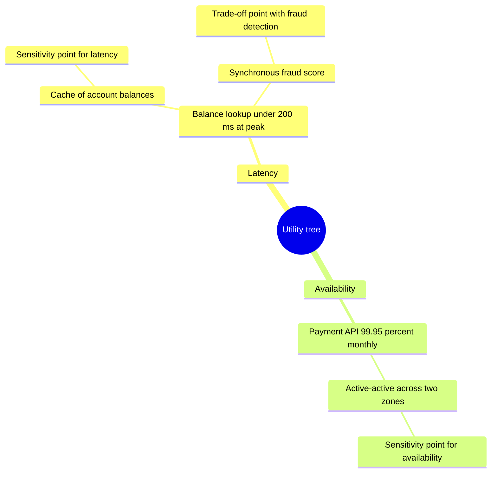
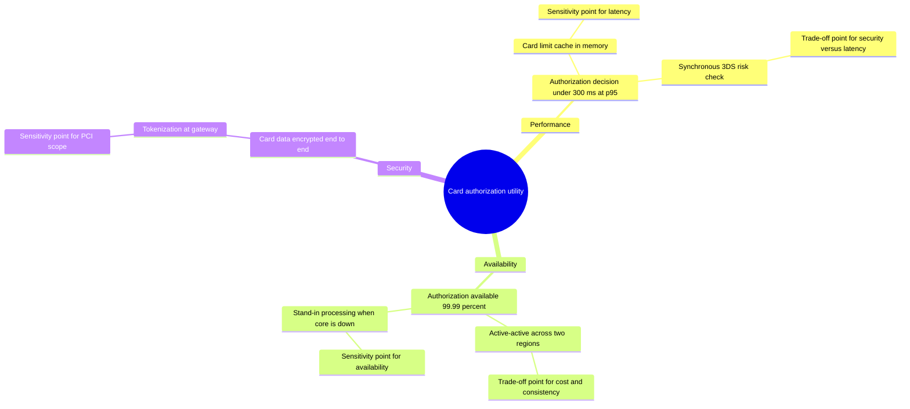

# Sensitivity / Trade-off Point Map (ATAM)

Mermaid type: `mindmap` (Close fit). Source: Modeling-Diagraming.md, section "Architecture Evaluation & Decision Support".

Identifies architectural decisions that strongly influence one or several quality attributes, showing which decisions are sensitive to change and where one attribute harms another.

## Example 1: Simple - Payments utility tree

## Example 2: Realistic - Card authorization utility tree

