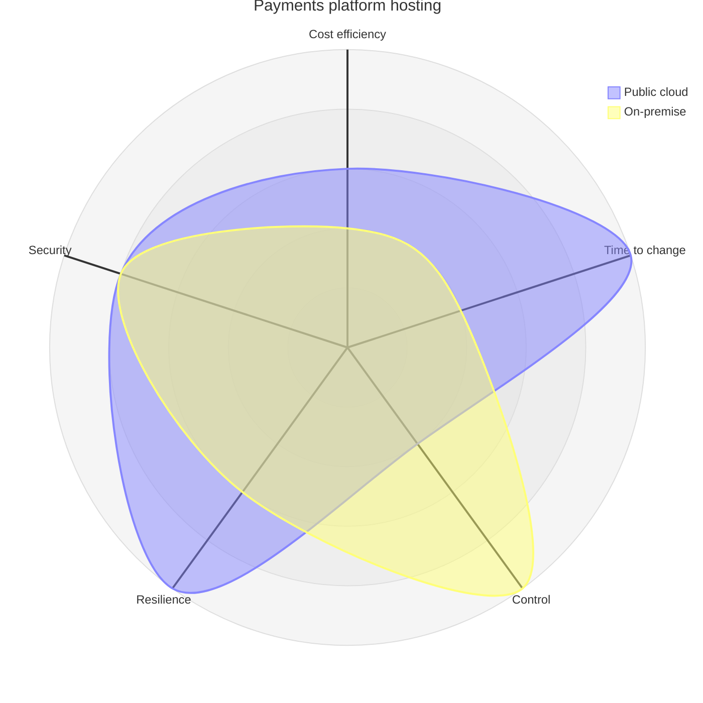
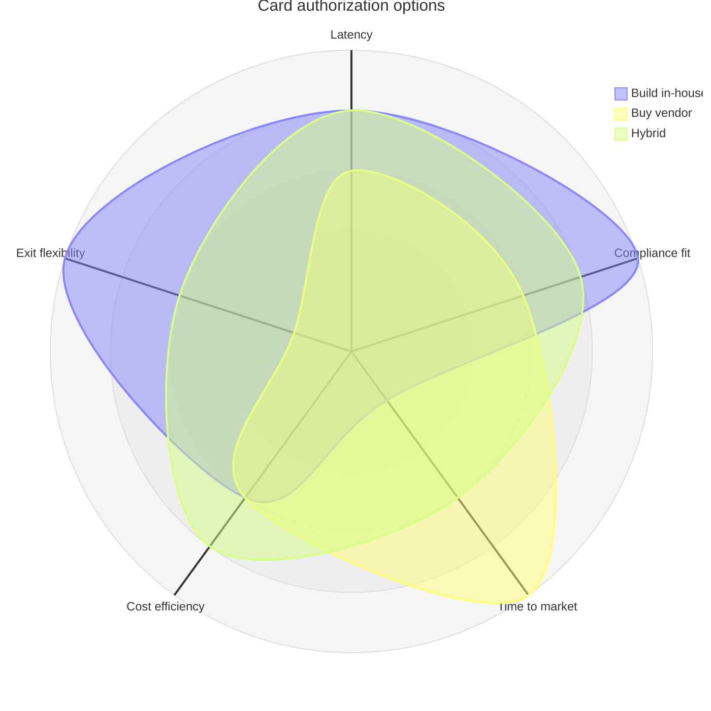

# Trade-off Map

Mermaid type: `radar-beta` (Close fit). Source: Modeling-Diagraming.md, section "Architecture Evaluation & Decision Support".

Visualizes competing quality attributes and architectural alternatives, showing what each option optimizes or sacrifices.

## Example 1: Simple - Payments platform hosting

## Example 2: Realistic - Card authorization engine options

