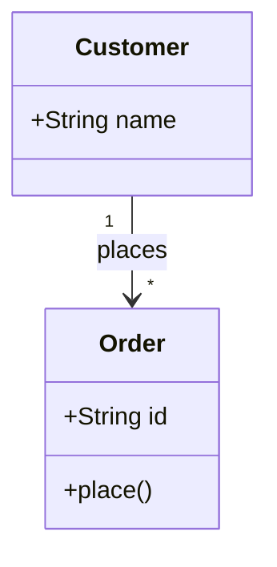
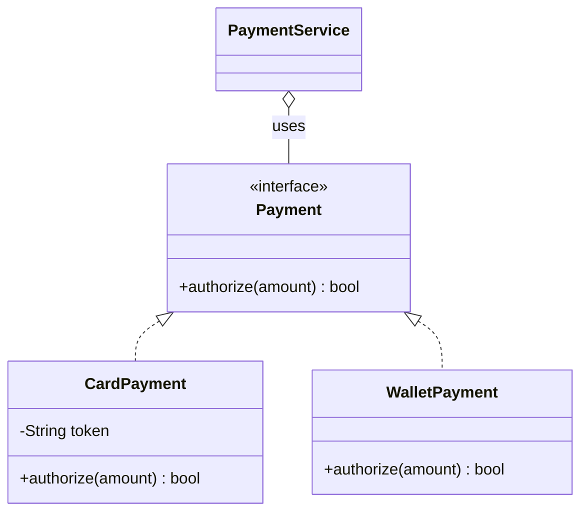

# Class diagram

Mermaid type: `classDiagram` (Native fit). UML type: class diagram.

Shows classes, attributes, operations, and relationships between them.

## Description

Static structure view showing classes, their attributes and operations, and relationships (association, inheritance, aggregation, composition, dependency).

## Example usages

- Domain model and entity relationships
- Designing interfaces and their implementations
- Documenting API contracts and DTOs
- Showing aggregation and composition within a module

## Example 1: Simple - Customer places orders

## Example 2: Complex - Payment interface with implementations

