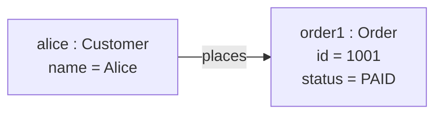
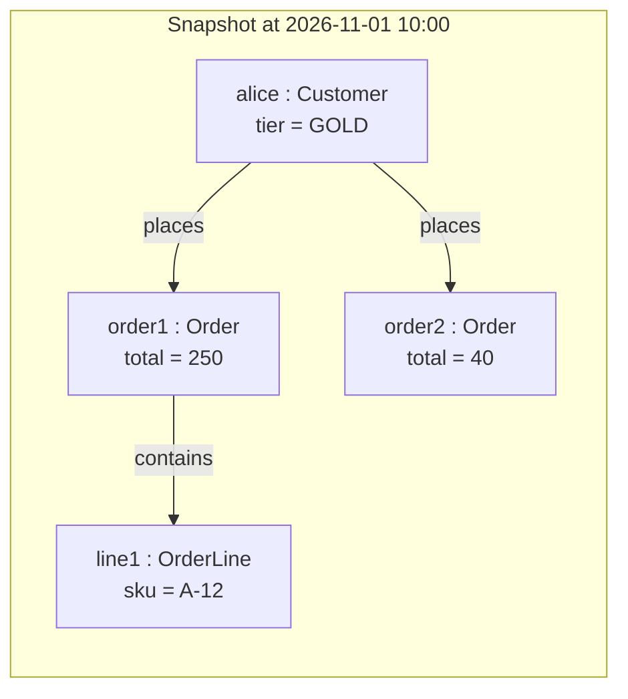

# Object diagram

Mermaid type: `flowchart` (Approximate fit). UML type: object diagram.

Mermaid has no object diagram. Instances are drawn as flowchart nodes with `name : Class` labels and slot values.

## Description

Snapshot of concrete instances and their links at one point in time, showing actual slot values.

## Example usages

- Illustrating a class model with concrete example data
- Debugging the state of objects at runtime
- Showing test fixtures or sample messages
- Explaining a complex object graph

## Example 1: Simple - One customer and one order

## Example 2: Complex - Snapshot of an order with lines

