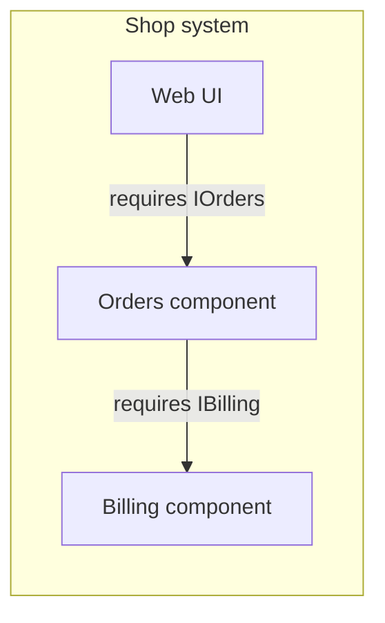

# Component diagram

Mermaid type: `flowchart` (Approximate fit). UML type: component diagram.

Mermaid has no component diagram. Components are drawn as flowchart nodes inside subgraphs, with labeled dependency edges standing in for required and provided interfaces.

## Description

Structure of the system as components with provided and required interfaces, showing how modules depend on each other.

## Example usages

- Modular monolith or microservice boundary overview
- Documenting third-party integrations and required services
- Showing replacement points where an implementation can be swapped behind an interface
- Planning team ownership of components

## Example 1: Simple - Web UI calls Orders API

## Example 2: Complex - Components with required interfaces

