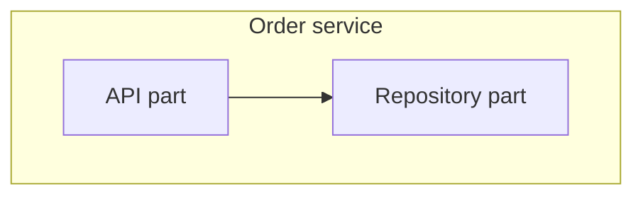
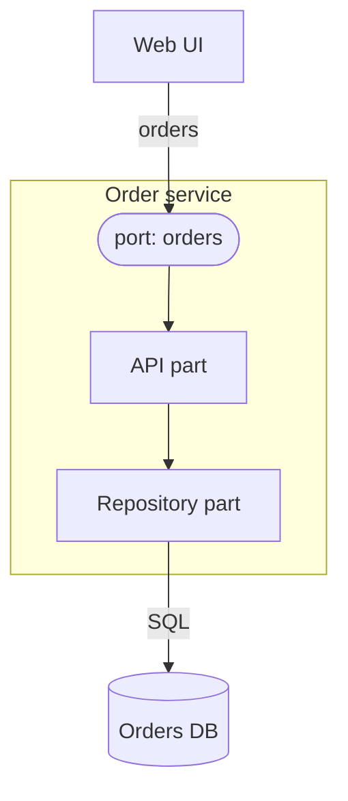

# Composite structure diagram

Mermaid type: `flowchart` (Approximate fit). UML type: composite structure diagram.

Mermaid has no composite structure diagram. Parts are nested as flowchart subgraphs, and ports are drawn as small nodes on the boundary.

## Description

Internal structure of a classifier, showing its parts, how they are connected through connectors, and the ports through which it interacts with its environment.

## Example usages

- Showing the internals of a service and its sub-components
- Defining ports and connectors for a component
- Describing collaboration within a single system boundary
- Explaining how dependencies are wired together

## Example 1: Simple - Parts inside a service

## Example 2: Complex - Service with a port and external database

