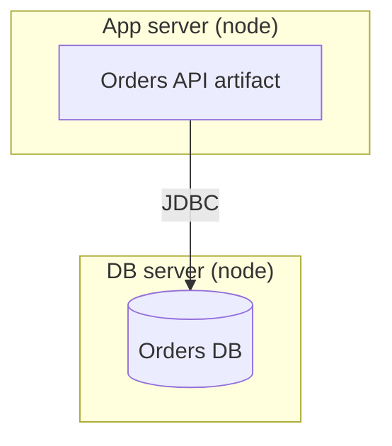
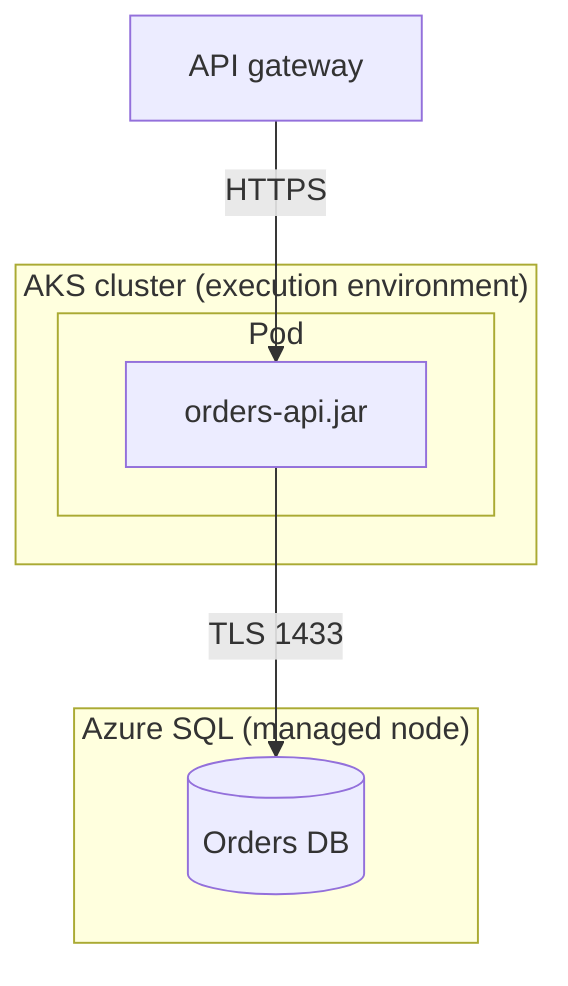

# Deployment diagram

Mermaid type: `flowchart` (Approximate fit). UML type: deployment diagram.

Mermaid has no deployment diagram. Nodes and execution environments are drawn as subgraphs, and deployed artifacts as nodes inside them.

## Description

Mapping of software artifacts onto hardware nodes and execution environments, including the communication paths between them.

## Example usages

- Infrastructure topology for cloud or on-premises systems
- Showing which artifact runs on which node or container
- Documenting network protocols and ports between nodes
- Comparing environments (dev, test, prod)

## Example 1: Simple - API and database on separate nodes

## Example 2: Complex - Containerized API with managed database

