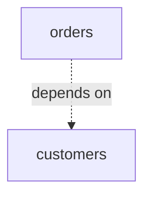
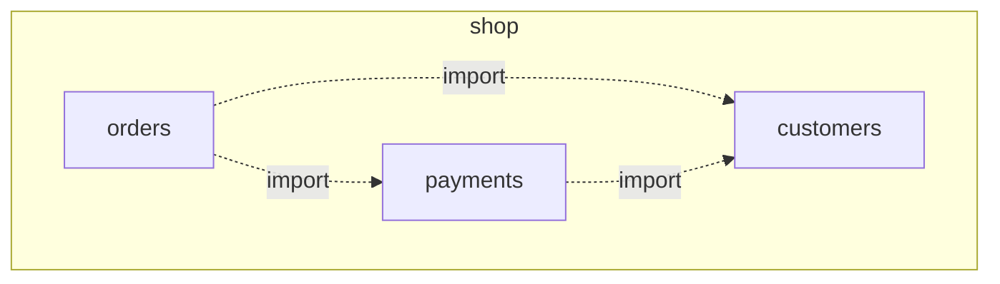

# Package diagram

Mermaid type: `flowchart` (Close fit). UML type: package diagram.

Packages are drawn as subgraphs, and dependencies as dashed edges. Mermaid's `namespace` in `classDiagram` is an alternative for grouping classes only.

## Description

Organization of model elements into packages (namespaces) and the dependencies between those packages.

## Example usages

- Module and layer structure of a codebase
- Checking for forbidden dependencies such as layer violations
- Organizing a large model by domain or bounded context
- Planning ownership or release boundaries

## Example 1: Simple - One package depends on another

## Example 2: Complex - Packages within a module

