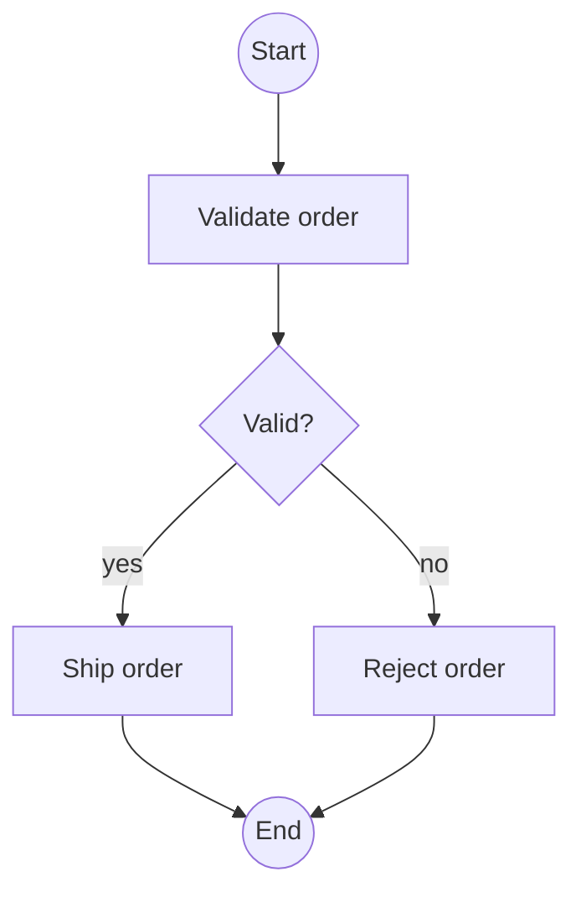
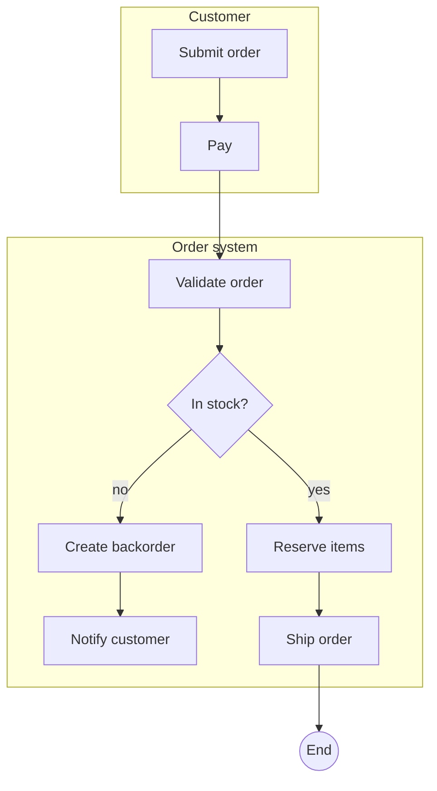

# Activity diagram

Mermaid type: `flowchart` (Close fit). UML type: activity diagram.

Actions are rectangles, decisions are diamonds, and swimlanes are approximated with subgraphs. Fork and join bars are not supported.

## Description

Workflow of actions and control flow, with decisions, merges, forks, and swimlanes showing who performs each action.

## Example usages

- Business process flow documentation
- Algorithm or business rule logic
- Showing parallel work and handoffs between actors or systems
- Analyzing approval and exception paths

## Example 1: Simple - Order validation

## Example 2: Complex - Order flow across two swimlanes

